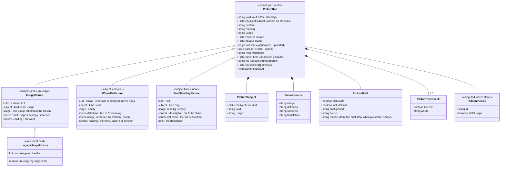

# AIGENKI Data Model

Entity-relationship diagram for all Firestore collections.
Global collections are independent of any user. Per-user collections live under `users/{uid}/`.
Types: `backend/src/types/` (and `frontend/src/types/`). Collection names: `backend/src/firebase/firebase.module.ts`.

Last checked against the code and the dev database on 2026-11-06. Field lists are the ones that
matter, not every field. Legacy fields that are still stored but no longer read are listed under
**Legacy data** below, not in the diagram.

**Admin routing:** the admin user (`ADMIN_USER_ID`) reads and writes the root `review-facets` and
`scenarios` collections; everyone else uses `users/{uid}/review-facets` and `users/{uid}/scenarios`
(see anomaly 11).

---

## Diagram

```mermaid
erDiagram

    %% ═══════════════════════════════════════════════════════
    %% GLOBAL COLLECTIONS
    %% ═══════════════════════════════════════════════════════

    KnowledgeUnit {
        string id PK
        string content       "canonical identifier: pattern (Grammar), word (Vocab/Kanji)"
        string type          "Vocab | Kanji | Grammar | ExampleSentence (Concept docs live in concepts)"
        array  relatedUnits  "KnowledgeUnit ids"
        string data_jlptLevel   "Vocab/Kanji/Grammar, may be null"
        number data_wanikaniLevel "Vocab/Kanji"
        string data_corpusNotes "AI prompt context, not lesson content"
        string data_title    "Grammar only"
        object data_classification "Grammar only: hand-authored, never AI-generated"
        object data_exampleInContext "Grammar only: seed for lesson generation"
        boolean data_scenarioReady "Grammar only: hand-set; starts a Flash card chain at SRS stage 3"
        string data_reading      "Vocab only"
        string data_definition   "Vocab only"
        string data_conjugationType "Vocab only"
        array  data_kanji        "Vocab only: distinct kanji in content (array-contains lookup)"
        string data_meaning  "Kanji only"
    }

    Concept {
        string id PK
        string content
        string type          "Concept"
        string createdBy
        string data_title
        string data_overview
        string data_reading  "optional kana reading of title"
        array  data_mechanics
        array  data_examples
    }

    Lesson {
        string kuId PK       "= KnowledgeUnit.id: one lesson per KU"
        string type          "Vocab | Kanji | Grammar"
        string status        "generating | completed | failed (+ error); absent on old lessons = completed; 10 old docs hold learning"
        object validation    "status: pending|pass|fail, checkedAt, violations[]"
        string vocab         "Vocab"
        string reading       "Vocab"
        array  definitions   "Vocab"
        string partOfSpeech  "Vocab"
        array  context_examples "Vocab: sentence, translation, usage label, usageId"
        array  usages        "Vocab: id (stable), label, meaning (the literal answer), acceptedAnswers"
        array  usageSetAside "Vocab: definitions no example shows, so not usages"
        array  component_kanji  "Vocab: filtered on read (dropStrayComponentKanji)"
        boolean kanaOnly     "Vocab: never taught with its kanji breakdown"
        string pattern       "Grammar: overridden with KU.content at read time"
        string title         "Grammar: overridden with KU.data.title at read time"
        string meaning       "Grammar and Kanji"
        string formation     "Grammar: string or string[]"
        string notes         "Grammar: editable; admin writes the global doc, users their overlay"
        array  examples      "Grammar: japanese, english, fragments, furigana, learnableTerms"
        string kanji         "Kanji: plus onyomi, kunyomi, strokes, radical, mnemonics, relatedVocab"
    }

    Picture {
        string id PK
        string kuId          "FK → KnowledgeUnit.id OR Concept.id; null for free-standing"
        object subject       "kind: ku-usage | ku | none, kuId, usage; absent on old docs = ku-usage"
        string content       "the subject's word or content, or a free-standing description"
        string reading
        string usage         "the usage label for ku-usage, empty otherwise (matched by usageKey)"
        object source        "what it was drawn from: usage, definition, sentence, translation"
        string status        "approved | needs-review | rejected | unpicturable"
        string origin        "uploaded; absent = generated"
        string style         "scene; absent = card"
        string note          "editor's note, or an upload's description"
        object brief         "picturable, includeCast, background, scene, reason?; absent on uploads"
        string file          "file name under PICTURES_DIR (local disk); absent if unpicturable"
        array  attempts      "text-check results: hasText, where"
    }

    Question {
        string id PK
        string kuId             "FK → KnowledgeUnit.id OR Concept.id"
        string sourceCollection "knowledge-units | concepts | scenarios; absent on old docs"
        object data             "question, answer, acceptedAlternatives, context, difficulty"
        string usageId          "Vocab: the usage the question tests; absent on older questions"
        number rank             "0–100, starts 50, suitable threshold 30; absent on old docs"
        number rejectionCount
    }

    ContentFlag {
        string id PK
        string sourceType    "lesson | facet | scenario"
        string sourceId      "FK → lesson kuId OR scenario id"
        string kuId          "FK → KnowledgeUnit.id (absent for scenario flags)"
        string userId        "scenario flags only: whose scenario"
        string kuContent     "human-readable label (word, pattern, or scenario title)"
        string userLevel     "user's jlptLevel at generation time"
        array  violations    "segment, detectedLevel, type (vocab|grammar)"
        string status        "open | resolved | dismissed"
        string manualNote    "manual flags only"
        string quotedSegment "manual flags only: the text being reported"
        string category      "manual flags only, e.g. Above level"
        string dismissNote
        timestamp resolvedAt
        timestamp createdAt
    }

    GrammarSection {
        string id PK
        string sectionLabel  "heading from the verb guide; display only"
        string pattern
        string jlptLevel
        string explanation
        array  examples      "few-shot source for scenario generation"
        array  vocab
        string notes
    }

    DailyPlan {
        string uid PK        "= users/{uid}: one cached plan per user"
        string date          "YYYY-MM-DD"
        number reviewsDue    "recomputed live when served"
        boolean suggestNewContent
        number threshold
        array  recentPromotions
        array  topLeeches
        array  practiceOpportunities "scenario opportunities; dismissing one patches this doc"
    }

    ApiLog {
        string id PK
        timestamp timestamp
        string route
        string status        "pending | success | error"
        string modelUsed
        number durationMs
        object requestData
        object responseData  "rawText, parsedJson, toolCalls, costUsd"
    }

    %% ═══════════════════════════════════════════════════════
    %% PER-USER  (users/{uid}/...)
    %% ═══════════════════════════════════════════════════════

    UserRoot {
        string uid PK        "= Firebase Auth UID"
        string email
        boolean isAdmin
        string lastDailyPlanDate "YYYY-MM-DD; gates the first-visit daily plan"
        object stats         "reviewForecast, hourlyForecast, currentStreak, totals, levelProgress, recentlyPromoted, scenarioOpportunities"
        object tutorContext  "frontierVocab, leechVocab, allowedGrammarKuIds, excludedVocab/Grammar, weakGrammarPoints, currentCurriculumNode"
        object preferences   "showFurigana, jlptLevel, preferredUserRole, audioFirstExperiment"
    }

    UserKnowledgeUnit {
        string kuId PK       "= KnowledgeUnit.id (subcollection user-kus)"
        string status        "learning | reviewing | mastered; owned by LearningProgressService"
        number facet_count
        number currentStage  "current facet sequence stage; owned by ReviewProgressService"
        string sequenceVariant "audio-first; absent = default sequence; fixed at enrollment"
        boolean aboveLevel   "true if ku.data.jlptLevel > user.preferences.jlptLevel at enrollment time"
        string source_type   "scenario | lesson | flag"
        string source_id     "FK → Scenario.id OR Lesson.kuId"
    }

    ReviewFacet {
        string id PK
        string kuId             "FK: collection given by sourceCollection; a Scenario.id for flash facets"
        string sourceCollection "knowledge-units | concepts | scenarios; absent on old docs; use resolveKuCollection()"
        string facetType        "incl. picture-choice (audio-first) and flash (one-off scenario card, no SRS)"
        number srsStage         "0–8"
        number sequenceStage    "the stage of the KU's facet sequence this facet belongs to"
        timestamp nextReviewAt
        number consecutiveFailures
        string currentQuestionId "FK → Question.id"
        array  provenUsageIds   "Vocab meaning card (Content-to-Definition): usages proven at the current srsStage"
        string source_type      "lesson | concept; absent on flash facets"
        string source_id
        object data             "facet-type payload; picture-choice holds a snapshot of the word's pictures, flash a scenario step"
    }

    Scenario {
        string id PK
        string title
        string difficultyLevel "N5..N1"
        object setting       "location, goal, visualPrompt, picture (rendered scene)"
        string sourceType    "library | custom | context-example | grammar-pattern"
        string sourceKuId    "FK → KnowledgeUnit.id (optional)"
        string sourceSectionId "FK → GrammarSection.id (grammar-pattern scenarios)"
        string state         "encounter | drill | simulate | completed"
        array  extractedKUs  "kuId refs FK → KnowledgeUnit.id"
        array  grammarMatches "kuId refs FK → KnowledgeUnit.id (Grammar), from get_grammar_patterns"
        array  liveExtractedKUs "mined from the user's own chat turns at completion"
        array  liveGrammarMatches
        boolean vocabReady   "Key Vocabulary and Key Grammar all at SRS stage 3+; never recomputed downwards"
        boolean isActive
        object roles
        object progress      "keyed by ScenarioDifficulty (N5..N1)"
    }

    UserGrammarLesson {
        string id PK         "= {kuId}_{sourceType}_{sourceId} (deterministic)"
        string kuId          "FK → KnowledgeUnit.id (Grammar type only)"
        string lessonId      "= kuId"
        string sourceType    "scenario | scenario-live | concept"
        string sourceId      "FK → Scenario.id OR Concept.id"
        string sourceTitle
        object contextExample "japanese, english, fragments, accepted_alternatives"
    }

    UserLessonOverlay {
        string kuId PK       "= KnowledgeUnit.id (subcollection user-lessons); merged on top of Lesson at read time"
        string any_section   "any lesson section a non-admin user edited, e.g. notes, meaning_explanation"
        string personalMnemonic "Kanji"
    }

    UserQuestionState {
        string questionId PK "FK → Question.id (subcollection question-states)"
        boolean rejected
        number  consecutiveFailures
    }

    UserConcept {
        string id PK         "(subcollection user-concepts)"
        string conceptId     "FK → Concept.id"
        timestamp startedAt
        timestamp lastSeenAt
    }

    %% ═══════════════════════════════════════════════════════
    %% RELATIONSHIPS
    %% ═══════════════════════════════════════════════════════

    KnowledgeUnit ||--o| Lesson : "generates (keyed by kuId)"
    Lesson o|--o{ ContentFlag : "flagged by validation"
    Scenario o|--o{ ContentFlag : "flagged by validation"
    KnowledgeUnit ||--o| UserLessonOverlay : "overlay (keyed by kuId)"
    KnowledgeUnit ||--o{ UserKnowledgeUnit : "enrolled as"
    KnowledgeUnit ||--o{ ReviewFacet : "drilled by (Vocab/Kanji/Grammar facets)"
    KnowledgeUnit ||--o{ Question : "questions drawn from"
    KnowledgeUnit ||--o{ UserGrammarLesson : "encountered as grammar"
    KnowledgeUnit o|--o{ Scenario : "sourceKuId"
    KnowledgeUnit ||--o{ Picture : "pictured by (usage or whole KU)"
    Concept ||--o{ Picture : "pictured by (whole KU)"

    Concept ||--o{ ReviewFacet : "drilled by (Concept facets)"
    Concept ||--o{ Question : "questions drawn from"
    Concept ||--o{ UserConcept : "enrolled as"
    Concept ||--o{ UserGrammarLesson : "introduces grammar via concept"

    GrammarSection o|--o{ Scenario : "sourceSectionId"
    Scenario ||--o{ ReviewFacet : "flash cards (one per Flash card chain step)"
    Scenario ||--o{ UserGrammarLesson : "introduces grammar via scenario"

    Question ||--o{ UserQuestionState : "per-user state"
    ReviewFacet o|--o| Question : "currentQuestionId"

    UserRoot ||--o| DailyPlan : "cached plan (daily-plans/{uid})"
    UserRoot ||--o{ UserKnowledgeUnit : "owns"
    UserRoot ||--o{ ReviewFacet : "owns"
    UserRoot ||--o{ Scenario : "owns"
    UserRoot ||--o{ UserGrammarLesson : "owns"
    UserRoot ||--o{ UserLessonOverlay : "owns"
    UserRoot ||--o{ UserQuestionState : "owns"
    UserRoot ||--o{ UserConcept : "owns"
```

Scenario scene images aren't `Picture` docs: they're stored on the scenario (`setting.picture`)
with the file under `PICTURES_DIR/scenarios/{uid}/`.

---

## Pictures in detail

One `pictures` collection, one TypeScript type (`PictureDoc` in `backend/src/types/index.ts`), but
the fields a doc carries depend on three things: its **subject kind**, its **origin** and its
**status**. The diagram shows the subject kinds as subtypes; the tables after it cover origin and
status, which cut across all three.

**Origin**, for any subject kind:

| | generated | uploaded |
|---|---|---|
| `origin` | absent | `"uploaded"` |
| `brief` | present | absent |
| `attempts` | one per render try | `[]` |
| `status` when made | needs-review (the text check's verdict is in `attempts`), or unpicturable | needs-review |
| `note` | the editor's steer, if any | whole-KU and free-standing only: a description |
| redraw | allowed, except when approved (a redraw lands in needs-review, which would unbind it) | refused |
| bulk generation | may delete it (stale usage, see below); a forced run adds a needs-review copy beside it rather than replacing it | never touches it; an active upload blocks generation for its usage |

**Status.** Nothing is approved automatically: every new or redrawn picture starts in needs-review.
"Bound" (shown to learners) means approved; a picture is only *made for* its subject until then.

| status | `file` | `brief` | meaning |
|---|---|---|---|
| approved | present | as per origin | bound: usage pictures are shown to learners |
| needs-review | present | as per origin | made for its subject, waiting for the admin |
| rejected | present | as per origin | hidden; reversible in admin |
| unpicturable | absent | present, `picturable: false`, `reason` | the brief step judged it can't be drawn (only the AI sets this; the admin redraws or rejects) |

A picture without a `file` can't be approved.

**Other rules worth knowing:**
- `style: "scene"` is only set when a picture is made with that style. Bulk generation always makes cards.
- Redrawing resets `createdAt`, so the admin list (newest first) brings a redrawn picture back to the top.
- Bulk generation counts a usage as covered by a picture of **any** status; the Add a Picture flow
  (`GET /pictures/admin/usages`) counts approved as bound, needs-review / unpicturable / being drawn as
  waiting, and rejected as nothing.
- Nothing yet stops a usage from getting a second picture beside a bound one (forced bulk runs; approving
  a second picture). The owner's rule: a usage that has a picture must not get another; a "remove before
  add" step is still to be designed. Add a Picture offers Generate/Upload only on usages with no
  picture, and Change word/usage won't move a picture onto a bound usage.
- Re-attaching (`PATCH subject`) rewrites `subject`, `kuId`, `content`, `reading`, `usage` and `source`
  but keeps `brief`, `file`, `status` and `attempts`. So a re-attached picture's brief can describe its
  old subject.
- `staleUsage` (admin list only) applies to uploaded usage pictures whose usage label is no longer in
  the lesson. A generated picture in that state is deleted instead, the next time bulk generation
  runs for its word, provided the word then has an **approved** picture for one of its current usages.

**In the dev database** (2026-11-06, 41 docs):

| kind | origin | approved | rejected | unpicturable |
|---|---|---|---|---|
| ku-usage, legacy (no `subject`) | generated | 14 | 2 | 2 |
| ku-usage, legacy (no `subject`) | uploaded | 3 | 2 | |
| ku-usage | generated | 2 | | |
| ku (whole KU) | generated | 14 | 2 | |
| none | | | | |

No needs-review, scene or free-standing pictures exist yet. Of the 16 whole-KU pictures, 15 are on Vocab words and one (approved) is on the **Kanji** 山 (`m4ZDGTODIeH0NY5bxlkt`), made before the never-a-Kanji rule (#340).

---

## Vocab usages and the meaning card

Design: `specs/learning-goal-model.md`.

- A Vocab lesson's `usages` are built from its examples and definitions (`LessonsService.buildVocabUsages`,
  `scripts/build-usages.ts`). Ids are stable; existing labels are kept verbatim because pictures match
  usages by label. Until built, `usagesOf()` treats the lesson as one usage accepting every definition.
- The **meaning card** is the Vocab `Content-to-Definition` facet: one SRS stage for the word. A correct
  answer is matched to a usage (locally, else by the AI with the usage list) and recorded in
  `provenUsageIds`. The card moves up only when every usage is proven at its stage; the record then
  clears. A wrong answer counts only while nothing is proven at that stage.
- From SRS stage 4 (`AI_QUESTION_MIN_STAGE`, a placeholder), a due meaning card with an unproven usage
  is served as an AI question about that usage (`presentAs`, `usageId` on the review item). The card and
  its SRS are unchanged. Vocab no longer gets `AI-Generated-Question` facets of its own; existing ones on
  old accounts keep their own SRS.

## Legacy data

Still in the dev database, but no code reads it:

| Where | What | Notes |
|---|---|---|
| `user-stats` (4 docs) | old per-user stats | replaced by `users/{uid}.stats`; `USER_STATS_COLLECTION` is still imported in `reviews.service.ts` but unused |
| `users/{uid}/feed` (10 docs) | `FeedItem` | the feed engine is on the unmerged `feat/feed-engine` branch; the type remains, and KU delete still cleans this subcollection |
| `users/{uid}/scenario-sessions` (43 docs) | `ScenarioSession` | the template/session split was never adopted; scenario state lives on the scenario |
| `users/{uid}/area-progress` (3 docs) | | no type, no code |
| `knowledge-units` | `userId`, `facet_count`, `status`, `personalNotes`, `userNotes` | removed from the type (anomaly 12), still on most older docs |
| `lessons` | `userId` | deleted from a lesson when it's next read |
| `lessons` | `conjugation_type` | old spelling of `conjugationType`, on about 167 lessons; nothing reads it |
| `user-kus` | `userId`, `id`, `history`, `personalNotes`, `userNotes` | per-user path makes `userId` redundant |
| `questions` | `userId`, `status`, `lastUsed`, `previousAnswers` | per-user question state moved to `question-states` |

---

## Anomalies & Inconsistencies

### 1. `ReviewFacet.kuId` is polymorphic
Points to `knowledge-units/{id}`, `concepts/{id}`, OR `users/{uid}/scenarios/{id}` depending on `facetType`. No field on the facet document indicates which collection to query — callers must know the implicit mapping from `facetType` to collection. This is the root cause of the vocab-gate problem documented in ARCHITECTURE.md. FIXED
### 2. `Question.kuId` is polymorphic
Same issue as ReviewFacet — points to `knowledge-units` OR `concepts`. `QuestionsService.generateAndSave` handles this with a try/catch fallback but there is no discriminant on the document. FIXED
### 3. `Concept` is not in `knowledge-units`
`ConceptKnowledgeUnit` is a subtype of `KnowledgeUnit` in the TypeScript union, but `Concept` documents live in the separate `concepts` collection. Code that queries `knowledge-units` never returns Concepts. The type definition implies a unified collection that does not exist.

**Decision (2026-05-10):** The ideal fix is to migrate Concept documents into `knowledge-units` and move the rich content (`overview`, `mechanics`, `examples`) into the `lessons` collection as a new `ConceptLesson` type — mirroring how Grammar works. Decided not to pursue this for now: the migration is large (two Firestore documents per concept, atomic writes, `UserConcept` → `UserKnowledgeUnit` backfill across all user sub-collections, frontend routing changes, and the freshly-written `sourceCollection: 'concepts'` values on review facets would become incorrect). Revisit when there is capacity for a coordinated migration script.

### 4. `GrammarKnowledgeUnit.data.jlptLevel` type mismatch
`jlptLevel` is present in the **frontend** `GrammarKnowledgeUnit.data` type and in Firestore data, but is **absent** from the **backend** type. Backend code accesses it via `(ku.data as any)?.jlptLevel`. The two type files are out of sync. FIXED

### 5. `GrammarLesson.classification` should not exist
`GrammarLesson` has `classification?: GrammarClassification`. Classification is hand-authored editorial data that lives on the KU and must never come from the AI. The field on the lesson type implies the AI could populate it, which it must not. FIXED

### 6. `GrammarKnowledgeUnit.data.corpusNotes` is architecturally misplaced
Corpus notes are AI prompt context — instructions that guide lesson generation — not intrinsic properties of the grammar pattern. They belong in a separate collection (discussed but not yet implemented).

### 7. `ReviewFacet.source.type` is incomplete
NOT APPLICABLE. Flash card facets (2026-11-05) are created for scenarios, but they carry no `source`
at all (`kuId` = the scenario id, `sourceCollection: 'scenarios'`). Apart from those, scenarios never
create facets directly. `sentence-assembly` facets are only created by Concepts (`concepts.service.ts`). The only values ever written to `source.type` are `'lesson'` and `'concept'`, which matches the union. A dead `'scenario'` branch in `resolveKuCollection` was removed.

### 8. `Scenario.grammarMatches[].kuId` is unvalidated
NOT APPLICABLE to current code. The `get_grammar_patterns` tool queries Firestore and returns real document IDs; the AI selects from that list. The prompt also instructs "Never invent IDs." Hallucination is structurally prevented for new scenarios. The legacy `grammarNotes` free-text path (`ensureGrammarKU`) does fuzzy-match and carries some risk, but only fires for scenarios created before the tool-based flow existed.

### 9. `UserGrammarLesson.userId` is redundant
Stored inside a path-scoped sub-collection (`users/{uid}/user-grammar-lessons`). The `uid` is already implicit in the Firestore path. The field adds nothing and can drift if the document is ever copied. FIXED — removed from type and write path; old documents are not backfilled (field is simply ignored on read).

### 10. `UserQuestionState.kuId` is denormalized
Copied from `Question.kuId` at creation time. If a Question document's `kuId` were ever corrected, the `UserQuestionState` would be stale. Low risk in practice but structurally fragile. FIXED — `kuId` removed from type and write path; nothing reads it back from state.

### 11. Dual-path collections for admin vs users
`review-facets` (root, admin) vs `users/{uid}/review-facets` (per-user), and `scenarios` (root, admin) vs `users/{uid}/scenarios` (per-user). Routing handled by helpers (`facetsColRef`, `scenariosColRef`) but every service that touches these must know to use the helper.

### 12. `KnowledgeUnitBase` carries deprecated user-state fields
`userId`, `personalNotes`, `userNotes`, `facet_count`, `history` are marked `@deprecated` on the global KU base type. These belong on `UserKnowledgeUnit`. They persist on Firestore documents and are read by some code paths. FIXED

### 13. `GrammarNote.explanation` vs `GrammarKnowledgeUnit.data.corpusNotes`
Scenario grammar extraction produces `GrammarNote` objects with an `explanation` field. The KU stores the same conceptual data as `corpusNotes`. Different field names for the same idea, in types that exist alongside each other. FIXED — `explanation` removed from `GrammarNote` type and tool schema; `ensureGrammarKU` never read it, and the `grammarNotes` path is legacy-only.

### 14. `Picture.subject` does two jobs
`subject` records both what a picture was **drawn from** (generation, redraw, bulk coverage) and where it's
**shown** (picture cards, audio-first, distractors). The "usage vs whole KU" kind is the result, and a
picture can belong to only one KU. Whole-KU pictures aren't shown to learners yet. Under discussion
(2026-11-06); nothing decided.

### 15. Picture reads bypass `PicturesService`
`lessons.service.ts` and `review-progress.service.ts` query the `pictures` collection directly, each
restating "approved, has a file, is a usage picture" (they share only `isUsagePicture`).

### 16. `picture-choice` facets snapshot their pictures
The facet's `data` holds `{id, file, usage}` for the word's approved pictures at enrollment, so pictures
added, redrawn or rejected later don't reach existing cards (#314). The snapshot shape has no type.
